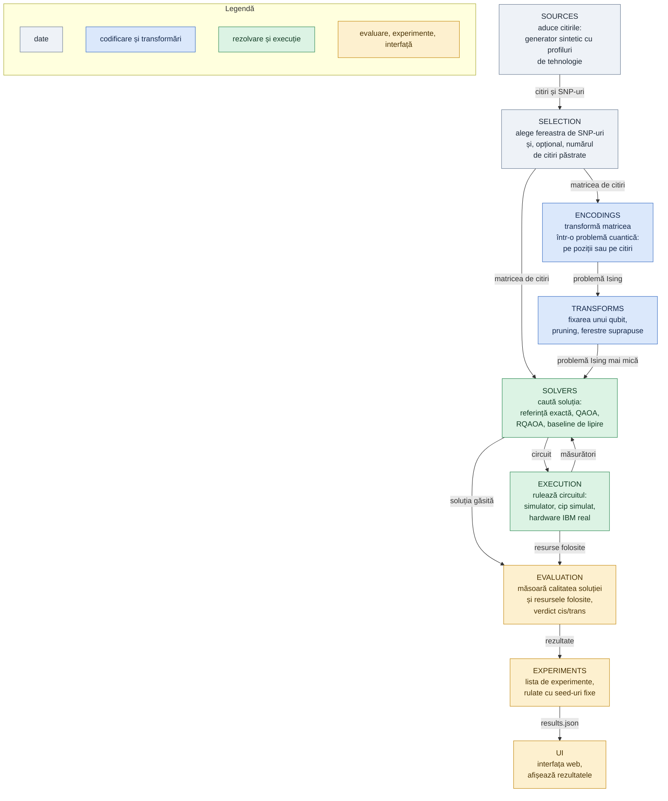

# Modulele NeuroQ

Codul este împărțit în module, fiecare cu o singură responsabilitate. Un modul primește de la cel dinainte rezultatul lui, îl prelucrează și îl dă mai departe, așa că oricine poate lucra pe modulul lui fără să cunoască restul. Săgețile arată ce se transmite între module.

## Ce face fiecare modul

| modul | ce face | primește | dă mai departe |
|---|---|---|---|
| sources | Aduce citirile unei regiuni. Poate genera date sintetice care imită Illumina (citiri scurte) sau Nanopore (citiri lungi) și traduce literele A/C/G/T în 0 și 1. | nimic (începutul lanțului) | citirile și SNP-urile regiunii |
| selection | Alege câte SNP-uri intră în problemă și, opțional, păstrează aleator un număr de citiri (downsampling), de exemplu 10–15 la Nanopore. Fereastra și numărul de citiri sunt butoanele experimentelor. | citirile și SNP-urile | matricea de citiri |
| encodings | Transformă matricea în problemă cuantică, în două feluri: un qubit pe poziție (metoda organizatorilor) sau un qubit pe citire (metoda noastră). Cele două au funcții de pondere separate. | matricea de citiri | problema Ising |
| transforms | Simplifică problema: fixează un qubit, elimină legăturile slabe, taie probleme mari în ferestre suprapuse. | problema Ising | aceeași problemă, mai mică |
| solvers | Caută soluția: enumerare exactă (referința), QAOA, RQAOA și baseline-ul clasic de lipire a citirilor. | problema Ising (baseline-ul: matricea de citiri) | soluția găsită |
| execution | Rulează circuitele pe simulator, pe un cip IBM simulat cu zgomot sau pe hardware real. Poate și doar să le compileze, ca să numărăm porțile fără să le rulăm. | circuitul | măsurători și resursele folosite (qubiți, porți, adâncime) |
| evaluation | Măsoară cât de bună e soluția (contradicții rămase, acuratețe față de adevăr, salturi greșite între copii) și cât a costat. Dă verdictul cis/trans. | soluția și resursele | rezultate |
| experiments | Definește lista de experimente (ce date, ce codificare, ce metodă) și le rulează cu seed-uri fixe, ca rezultatele să se poată reproduce. | rezultatele | results.json |
| ui | Interfața web. Citește doar results.json, deci nu depinde de Qiskit. | results.json | — |
