# Pipeline-ul NeuroQ: cum curg datele

Pipeline-ul pornește din citirile de ADN ale unei persoane și reconstruiește cele două copii ale unei regiuni din cromozom (phasing). Aceeași matrice de citiri poate fi transformată în problemă cuantică în două feluri: cu un qubit pe fiecare poziție SNP (metoda organizatorilor) sau cu un qubit pe fiecare citire (metoda noastră). Le comparăm pe date de tip Illumina (citiri scurte) și Nanopore (citiri lungi), pe simulator și pe hardware IBM real. Căsuțele punctate sunt extensii opționale.

```mermaid
flowchart LR
    SRC["SURSĂ<br/>date sintetice cu profil<br/>Illumina sau Nanopore,<br/>sau date reale GIAB HG002<br/>extrase în Colab"]
    SEL["SELECȚIE<br/>alegem fereastra<br/>de SNP-uri; opțional,<br/>păstrăm aleator 10–15 citiri<br/>(downsampling)"]
    RM["MATRICEA DE CITIRI<br/>citiri × SNP-uri<br/>cu 0, 1 și lipsă;<br/>mutațiile V1 și V2<br/>marcate"]
    POS["CODIFICARE PE POZIȚII<br/>un qubit pe SNP;<br/>citirile votează pe<br/>perechi de poziții;<br/>J = (opus − la fel) / 2"]
    RD["CODIFICARE PE CITIRI<br/>un qubit pe citire;<br/>J = (contraziceri −<br/>potriviri) / 2"]
    GR["BASELINE CLASIC<br/>lipirea lacomă<br/>a citirilor,<br/>direct pe matrice"]
    TR["FIXAREA UNUI QUBIT<br/>elimină oglinda<br/>copia A ↔ copia B<br/>și un qubit"]
    PR["PRUNING<br/>eliminăm cuplajele<br/>slabe, cu J aproape<br/>de zero"]
    ST["FERESTRE SUPRAPUSE<br/>tăiem 50 de SNP-uri<br/>în ferestre mici<br/>și le lipim"]
    EXA["REFERINȚĂ EXACTĂ<br/>verificăm toate<br/>șirurile posibile"]
    QA["QAOA<br/>circuit H, rz, rzz, rx;<br/>unghiuri antrenate<br/>cu COBYLA"]
    RQ["RQAOA<br/>fixare repetată,<br/>ghidată de QAOA"]
    EXE["EXECUȚIE<br/>simulator ideal,<br/>cip IBM simulat cu zgomot,<br/>hardware IBM real;<br/>sau doar compilare<br/>pentru resurse"]
    DEC["DECODARE<br/>copia A, copia B,<br/>citiri suspecte"]
    EV["EVALUARE<br/>cost, MEC, acuratețe,<br/>switch errors,<br/>frecvența optimului,<br/>verdict cis/trans,<br/>qubiți și porți"]
    RES["RESULTS.JSON<br/>un rând pentru<br/>fiecare experiment"]
    UI["INTERFAȚĂ WEB<br/>browser de cromozom,<br/>încredere, comparații,<br/>curbe de resurse"]

    SRC --> SEL --> RM
    RM --> POS
    RM --> RD
    RM --> GR
    POS --> TR
    RD --> TR
    TR -.-> PR
    POS -.-> ST
    TR --> EXA
    TR --> QA
    PR -.-> QA
    ST -.-> QA
    TR -.-> RQ
    QA --> EXE
    RQ -.-> EXE
    EXA --> DEC
    EXE --> DEC
    GR --> DEC
    DEC --> EV --> RES --> UI

    subgraph LEG["Legendă"]
        direction TB
        L1["date"]
        L2["codificare și transformări"]
        L3["rezolvare și execuție"]
        L4["evaluare și rezultate"]
        L5["opțional"]
    end

    classDef date fill:#eef2f7,stroke:#6b7c93,color:#1f2a37
    classDef enc fill:#dbe8fb,stroke:#3b6fc4,color:#14284b
    classDef solve fill:#dcf3e4,stroke:#2f8a55,color:#123b24
    classDef eval fill:#fdf0cf,stroke:#c48a12,color:#4a3305
    classDef opt fill:#efe4fb,stroke:#7a4fc4,color:#2e1a4f,stroke-dasharray:5 5

    class SRC,SEL,RM,L1 date
    class POS,RD,TR,L2 enc
    class GR,EXA,QA,EXE,DEC,L3 solve
    class EV,RES,UI,L4 eval
    class PR,ST,RQ,L5 opt
```

## Ce face fiecare pas

| pas | ce face |
|---|---|
| Sursă | Aduce citirile unei regiuni de genom. Pot fi generate de noi, imitând o tehnologie reală (Illumina: citiri scurte, Nanopore: citiri lungi), sau extrase din datele publice Genome in a Bottle, proba HG002, unde phasing-ul corect este cunoscut. |
| Selecție | Alege câte SNP-uri intră în problemă (fereastra) și, opțional, păstrează aleator un număr de citiri (downsampling). Fereastra și numărul de citiri sunt butoanele principale ale experimentelor. Detalii despre downsampling mai jos. |
| Matricea de citiri | Fiecare rând este o citire, fiecare coloană un SNP. 0 înseamnă litera de referință, 1 litera alternativă, iar lipsa înseamnă că citirea nu acoperă poziția. Mutațiile urmărite (V1, V2) sunt două coloane etichetate. |
| Codificare pe poziții | Metoda organizatorilor. Fiecare citire votează, pentru fiecare pereche de poziții pe care o acoperă, dacă au aceeași literă (la fel) sau litere diferite (opus). Cu A voturile „la fel" și D voturile „opus" ale unei perechi, cuplajul este J = (D − A) / 2, iar fiecare poziție devine un qubit. |
| Codificare pe citiri | Metoda noastră. Compară citirile două câte două pe SNP-urile pe care le au în comun. Cu a potrivirile și d contradicțiile dintre două citiri, cuplajul este J = (d − a) / 2, iar fiecare citire devine un qubit. Citirile din aceeași copie se potrivesc, cele din copii diferite se contrazic, deci un J pozitiv le separă în echipe diferite. Are propria funcție de pondere, separată de cea pe poziții. |
| Baseline clasic | Lipește citirile una de alta, pornind de la prima. Este intuitivă, dar greșește la erori și depinde de ordinea citirilor. O folosim ca punct de comparație. |
| Fixarea unui qubit | Copiile A și B sunt oglinzi una a celeilalte, deci putem fixa un qubit fără să pierdem nimic. Problema are un qubit mai puțin, iar soluția nu se mai împarte între două variante identice. |
| Pruning | Elimină legăturile slabe dintre qubiți, ca circuitul să aibă mai puține porți. |
| Ferestre suprapuse | Pentru probleme prea mari, rezolvă bucăți mici care se suprapun și le lipește pe SNP-urile comune. |
| Referință exactă | Verifică toate soluțiile posibile. Dă răspunsul corect garantat pentru probleme mici și ne spune dacă QAOA a găsit optimul. |
| QAOA | Algoritmul cuantic: un circuit cu parametri antrenați astfel încât, la măsurare, să apară cât mai des soluția cu cele mai puține contradicții. |
| RQAOA | Rulează QAOA, fixează legătura cea mai sigură, micșorează problema și repetă. |
| Execuție | Rulează circuitul pe simulator, pe un cip IBM simulat cu zgomot sau pe hardware IBM real. Poate și doar să compileze circuitul pentru un cip, ca să numărăm porțile fără să-l rulăm. |
| Decodare | Transformă rezultatul măsurat în cele două copii și marchează citirile care nu se potrivesc cu niciuna (probabil erori). |
| Evaluare | Măsoară cât de bună e soluția (contradicții rămase, acuratețe față de adevăr, salturi greșite între copii) și cât a costat (qubiți, porți cu doi qubiți, adâncime). Dă și verdictul cis/trans pentru cele două mutații. |
| results.json | Toate rezultatele, câte un rând pe experiment. |
| Interfață web | Arată citirile pe cromozom sortate în cele două copii, încrederea rezultatului și comparațiile dintre metode. |

## Despre downsampling

Funcția este aceeași pentru ambele tehnologii: alegere aleatoare a unui număr țintă de citiri, cu seed fix, ca rezultatele să se poată reproduce. Diferă momentul în care o aplicăm:

| situație | downsampling |
|---|---|
| Nanopore, codificare pe citiri | da, 10–15 citiri; altfel numărul de qubiți ar depăși numărul de poziții |
| Illumina, codificare pe poziții | nu; folosim toate citirile, iar qubiții sunt numărul de SNP-uri |
| Illumina, codificare pe citiri | nu; ar rămâne multe poziții nelegate, iar scopul este să arătăm câți qubiți ar fi necesari (sute) |
